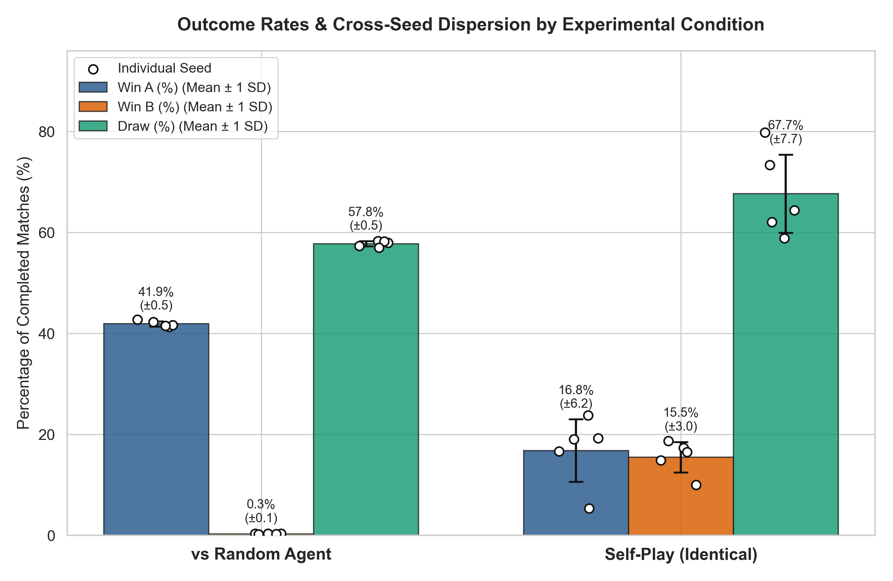
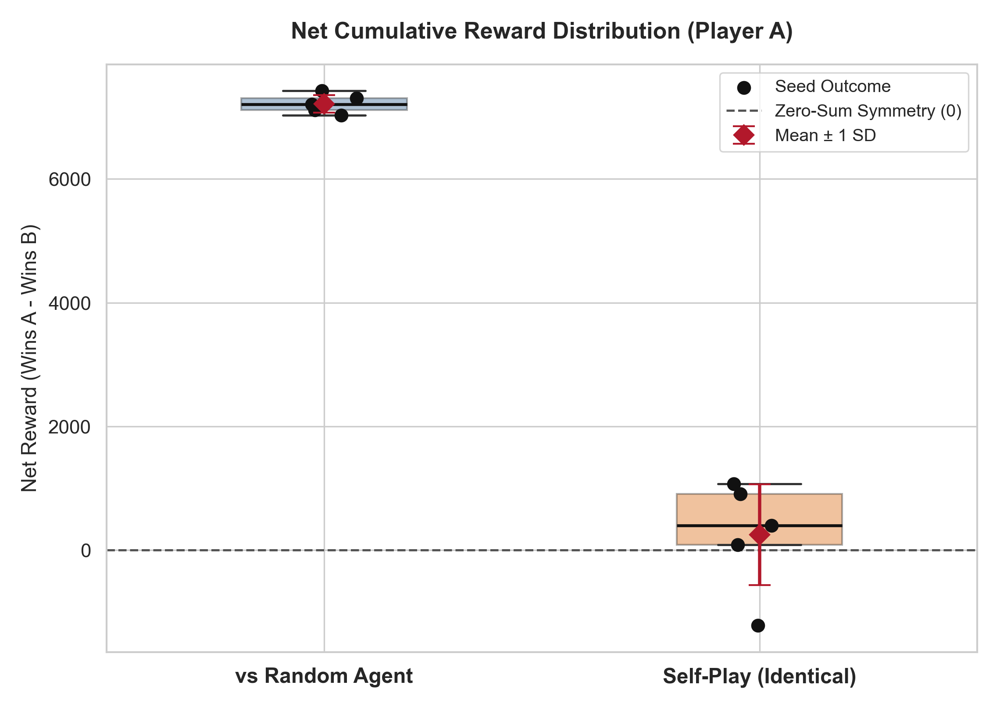
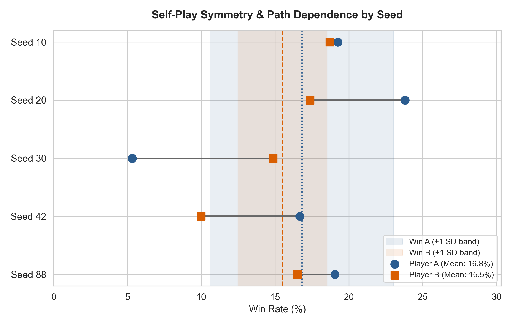
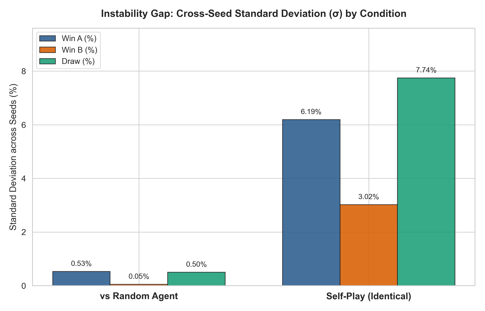

# Multi-Agent Reinforcement Learning in Gridworld Soccer (Markov Games)

An implementation and empirical evaluation of **Belief-Based Joint Action Learning (JAL)** in a two-player zero-sum Markov Game, reproducing the classic gridworld soccer environment introduced by Michael L. Littman (*"Markov games as a framework for multi-agent reinforcement learning"*, ICML 1994).

This repository isolates the dynamics of multi-agent Q-learning with empirical opponent modeling under both **stationary** (vs. uniform random policy) and **non-stationary** (independent self-play) regimes, accompanied by a reproducible multi-seed benchmark and automated statistical reporting.

---

## Project Structure

```text
MARL/
├── src/
│   ├── __init__.py
│   ├── environment.py                  # Symmetric 5x4 zero-sum FootballEnv (Littman, 1994)
│   └── agents.py                       # BeliefLearner (JAL Q-learning) & RandomAgent
├── intel_reports/
│   └── results_20261118_120319/        # Generated CSV, LaTeX tables, and 300 DPI figures
│       ├── 01_outcome_rates_variance.png
│       ├── 02_net_reward_distribution.png
│       ├── 03_self_play_seed_dynamics.png
│       ├── 04_cross_seed_volatility.png
│       ├── summary_metrics.csv
│       ├── summary_metrics.tex
│       ├── per_seed_metrics.csv
│       └── per_seed_metrics.tex
├── main.py                             # Multi-seed training and evaluation harness
├── intel.py                            # Standalone analytics, LaTeX exporter, and plotting CLI
└── README.md
```

---

## Core Implementations

### 1. Symmetric Gridworld Soccer Environment (`src/environment.py`)
`FootballEnv` implements a two-player zero-sum Markov Game on a $5 \times 4$ grid ($\text{width} = 5$, $\text{height} = 4$):
* **Initial State:** Player A starts at $(1, 3)$, Player B starts at $(2, 1)$, and initial ball possession $p \in \{0, 1\}$ is assigned uniformly at random on every `reset()`.
* **Action Space:** Both agents simultaneously select an action from $\{\texttt{"0"}, \texttt{"N"}, \texttt{"S"}, \texttt{"E"}, \texttt{"W"}\}$ (stay or move cardinally).
* **Collision & Resolution Symmetry:** Move execution order is randomized via a fair coin flip at every step. If a player attempts to move into the cell currently occupied by the opponent, the move is blocked and ball possession transfers to the other player.
* **Scoring & Effective Discounting:** Moving with the ball into the opponent's two-cell goal (column $-1$ for Player A, column $5$ for Player B, across middle rows $1$ and $2$) yields $+1$ to the scorer, $-1$ to the defender, and terminates the match. At every step, the match also has a $10\%$ probability of terminating in a draw ($0$ reward), inducing an effective temporal discount factor of $\gamma_{\text{eff}} = 0.9$.

### 2. Belief-Based Joint Action Learner (`src/agents.py`)
`BeliefLearner` maintains a joint action-value table $Q(s, a, o)$ over all $5 \times 5$ action pairs and an empirical count vector $N(s, o)$ tracking opponent action frequencies in each state $s$ (initialized with a uniform Dirichlet prior $\mathbf{1}_5$):
* **Expected Value Action Selection:** Given the normalized empirical belief distribution $P(o \mid s) = \frac{N(s, o)}{\sum_{o'} N(s, o')}$, the agent evaluates each candidate action via:
  $$V(s, a) = \sum_{o} Q(s, a, o)\, P(o \mid s)$$
  During training, actions follow an $\epsilon$-greedy policy ($\epsilon = 0.2$) with **uniform random tie-breaking** among optimal actions to avoid directional bias; during evaluation, $\epsilon = 0.0$.
* **Joint Bellman Update & Belief Tracking:** After observing joint transition $(s, a, o, r, s')$, the Q-table and belief tracker are updated as:
  $$Q(s, a, o) \leftarrow (1 - \alpha)\, Q(s, a, o) + \alpha \left(r + \gamma \max_{a'} \sum_{o'} Q(s', a', o')\, P(o' \mid s')\right)$$
  $$N(s, o) \leftarrow N(s, o) + 1$$
  with $\gamma = 1.0$ (since temporal discounting is already embedded in the environment's $10\%$ random termination probability).

### 3. Reproducible Multi-Seed Harness (`main.py`)
* **Step-Based Protocol:** Matches Littman's original experimental protocol with $1{,}000{,}000$ training steps (annealing $\alpha$ from $1.0$ to $\approx 0.01$ via $\alpha_{t+1} = 0.9999954\,\alpha_t$) followed by $100{,}000$ frozen evaluation steps ($\epsilon = 0.0$).
* **Isolated PRNG Streams:** Evaluates across five fixed seeds (`[10, 20, 30, 42, 88]`), using `np.random.SeedSequence.spawn(6)` to provide independent `np.random.Generator` streams to each environment and agent instance.

### 4. Automated Reporting & Visualization (`intel.py`)
A standalone post-processing CLI that automatically locates the latest `results_*.json` archive (or accepts custom paths via `-i` / `-o`) and generates CSV datasets, `booktabs` LaTeX tables, and 300 DPI variance-focused figures.

---

## Usage

### Running the Multi-Seed Experiment
```bash
python main.py
```
This trains and evaluates both experimental conditions (`vs Random Agent` and `Self-Play`) across all 5 seeds and saves a timestamped report (`results_YYYYMMDD_HHMMSS.json`).

### Generating Tables and Plots
```bash
# Automatically process the most recent results_*.json file
python intel.py

# Or target a specific JSON file and custom output directory
python intel.py --input results_20261118_120319.json --output-dir ./intel_reports/results_20261118_120319
```

---

## Key Experimental Results

Aggregated performance across $5$ seeds ($1{,}000{,}000$ training steps and $100{,}000$ evaluation steps per seed):

| Condition | Completed Matches ($n$) | Win A ($\%$) | Win B ($\%$) | Draw ($\%$) | Net Reward A |
| :--- | :---: | :---: | :---: | :---: | :---: |
| **vs Random Agent** | $17341.8 \pm 118.4$ | $41.91 \pm 0.53$ | $0.32 \pm 0.05$ | $57.78 \pm 0.50$ | $+7212.6 \pm 139.0$ |
| **Self-Play (Identical)** | $15023.8 \pm 1573.5$ | $16.82 \pm 6.19$ | $15.49 \pm 3.02$ | $67.69 \pm 7.74$ | $+250.2 \pm 813.6$ |

### Main Takeaways
1. **Convergence in Stationary MDPs:** Against `RandomAgent`, `BeliefLearner` reliably learns an offensive policy that wins **$41.91\% \pm 0.53\%$** of matches while conceding only **$0.32\% \pm 0.05\%$**, with negligible cross-seed variance.
2. **Environmental Symmetry Verified:** In self-play (`Identical`), the aggregate win rates of Player A (**$16.82\% \pm 6.19\%$**) and Player B (**$15.49\% \pm 3.02\%$**) are statistically indistinguishable, and the mean net reward ($+250.2 \pm 813.6$) lies well within one standard deviation of zero.
3. **Non-Stationarity & Deterministic Policy Limits:** In zero-sum self-play, cross-seed standard deviation increases by more than an order of magnitude ($\sigma_{\text{Win A}} = 6.19\%$ vs. $0.53\%$), with individual runs exhibiting strong path dependence (e.g., Seed 20 favors A at $23.80\%$ vs. $17.37\%$, whereas Seed 30 reverses in favor of B at $5.33\%$ vs. $14.86\%$). Furthermore, because greedy evaluation ($\epsilon = 0.0$) yields deterministic policies unable to represent mixed Nash equilibria, frontal stalemates increase the draw rate from $57.78\%$ to **$67.69\%$**.

---

## Visual Analysis (`./intel_reports/results_20261118_120319`)

### 1. Outcome Rates & Cross-Seed Dispersion


### 2. Net Cumulative Reward Distribution


### 3. Self-Play Symmetry & Path Dependence by Seed


### 4. Instability Gap: Cross-Seed Volatility ($\sigma$)
